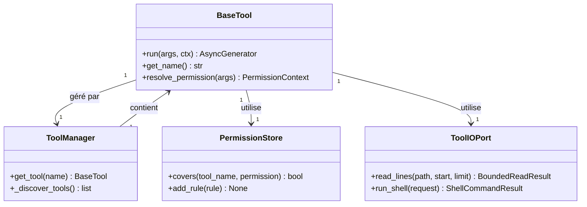

# Système d'outils de Mistral Vibe

> **Dossier** : `vibe/core/tools/`
> **Rôle** : Permet à l'agent d'exécuter des actions (fichiers, shell, services externes)
> **Version** : 1.0
> **Date** : 2026-10-31

---

## 📌 Résumé en une phrase

**Ce répertoire implémente le système qui transforme les instructions de l'IA en actions concrètes** : lecture/écriture de fichiers, exécution de commandes shell, appels à des APIs externes.

---

## 🎯 Rôle principal

Sans ce système, Mistral Vibe serait un simple chat sans capacité d'action. Les outils sont le **pont entre le raisonnement de l'IA et l'environnement d'exécution**.

---

## 📁 Structure du répertoire

```
vibe/core/tools/
├── base.py              # ⭐ Classe BaseTool (fondamentale)
├── manager.py           # 🎯 ToolManager (découverte & gestion)
├── models.py            # 🔐 Modèles de permissions
├── permissions.py       # 🛡️ Gestion des autorisations
├── io_port.py           # 🔌 Interface I/O (fichiers, shell)
├── utils.py             # 🛠 Utilitaires partagés
├── terminal_runtime.py  # ⏱️ Runtime terminal
├── ui.py                # 🎨 Affichage dans l'interface
│
├── builtins/            # 🛠 17 outils intégrés (voir doc dédiée)
├── connectors/          # 🔗 Système de connecteurs (voir doc dédiée)
└── mcp/                 # 🌐 Intégration MCP (voir doc dédiée)
```

---

## 🏗️ Architecture

### 1. **BaseTool** : La classe mère

Toute classe d'outil hérite de `BaseTool[ToolArgs, ToolResult, ToolConfig, ToolState]` :

- **`ToolArgs`** : Modèle Pydantic pour valider les arguments
- **`ToolResult`** : Modèle Pydantic pour le résultat
- **`ToolConfig`** : Configuration (permissions, allowlist, denylist)
- **`ToolState`** : État persistant entre les appels

**Méthodes clés** :
```python
async def run(self, args: ToolArgs, ctx: InvokeContext) -> AsyncGenerator
```

### 2. **ToolManager** : Le gestionnaire

- **Découvre** les outils disponibles (builtins, MCP, connecteurs)
- **Charge** les classes dynamiquement
- **Instancie** les outils avec leur configuration
- **Sélectionne** l'outil approprié (par nom et priorité)

### 3. **PermissionStore** : La sécurité

Gère les règles de permission avec 3 niveaux :
- `ALWAYS` : Toujours autorisé
- `NEVER` : Toujours bloqué
- `ASK` : Demande confirmation à l'utilisateur

**Mécanismes** :
- `allowlist` : Commandes/fichiers toujours autorisés
- `denylist` : Commandes/fichiers toujours bloqués
- `sensitive_patterns` : Motifs sensibles (ex: `rm -rf`)
- `Workspace` : Restriction aux dossiers de confiance

---

## 📦 Composants principaux

| Fichier | Rôle | Importance |
|---------|------|------------|
| `base.py` | Classe de base pour tous les outils | ⭐⭐⭐⭐⭐ |
| `manager.py` | Découverte et gestion des outils | ⭐⭐⭐⭐⭐ |
| `permissions.py` | Gestion des autorisations | ⭐⭐⭐⭐⭐ |
| `models.py` | Modèles de données (ToolPermission, etc.) | ⭐⭐⭐⭐ |
| `io_port.py` | Interface pour les opérations I/O | ⭐⭐⭐⭐ |
| `ui.py` | Affichage des résultats dans l'UI | ⭐⭐⭐ |
| `utils.py` | Fonctions utilitaires | ⭐⭐⭐ |
| `terminal_runtime.py` | Exécution de commandes terminal | ⭐⭐⭐ |

---

## 🧩 Sous-répertoires (docs séparées)

| Répertoire | Contenu | Nombre | À documenter |
|------------|---------|--------|--------------|
| `builtins/` | Outils intégrés (read_file, bash, etc.) | 17 outils | ✅ **Oui** |
| `connectors/` | Système de connecteurs (Google Drive, etc.) | 3 fichiers | ✅ **Oui** |
| `mcp/` | Intégration Model Context Protocol | 6 fichiers | ✅ **Oui** |

---

## 🔧 Flux d'exécution

```mermaid
flowchart TD
    A[Agent reçoit une demande] --> B[Sélectionne l'outil]
    B --> C[Valide les arguments]
    C --> D[Vérifie les permissions]
    D -->|✅| E[Exécute tool.run()]
    D -->|❌| F[Demande confirmation]
    F -->|Utilisateur accepte| E
    F -->|Utilisateur refuse| G[Annule]
    E --> H[Retourne le résultat]
    H --> I[Affichage dans l'UI]
```

---

## 🧪 Tests

### Organisation

```
tests/
├── core/tools/          # Tests unitaires (composants isolés)
│   ├── builtins/        # Tests des outils builtins
│   ├── test_base_arg_result_resolution.py
│   └── test_terminal_runtime.py
│
└── tools/              # Tests d'intégration
    ├── test_bash.py              # ~3500 lignes
    ├── test_granular_permissions.py
    ├── test_connectors.py
    ├── test_mcp.py
    └── ... (20+ fichiers)
```

### Statistiques

| Métrique | Valeur |
|----------|--------|
| Fichiers de test | 25+ |
| Nombre de tests | 1000+ |
| Lignes de test | ~20 000 |
| Couverture | ~80-90% (outils core) |

### Exemples de tests

- **Unitaires** : Validation des arguments, résolution des permissions
- **Intégration** : Exécution complète d'outils (bash, read_file)
- **Permissions** : Tests exhaustifs des règles de sécurité
- **Connecteurs** : Mocking des APIs externes

---

## ✅ Qualité du code

### Outils utilisés

| Outil | Rôle | Version |
|-------|------|---------|
| **Pyright** | Typage statique | 1.1.403+ |
| **Ruff** | Linting + formatage | 0.15.18+ |
| **Typos** | Correction de fautes | 1.34.0 |
| **Pre-commit** | Hooks git | 4.2.0+ |

### Configuration Ruff (extrait)

```toml
[tool.ruff.lint]
select = ["F", "I", "D2", "UP", "TID", "ANN", "PLR", "B0", "B905", "RUF*"]
ignore = ["D203", "D205", "D213", "ANN401", "PLR6301"]
line-length = 88
target-version = "py312"
```

### Pre-commit hooks

```yaml
- pyright           # Typage statique
- ruff-check        # Linting avec corrections
- ruff-format       # Vérification du formatage
- check-toml/yaml   # Validation des fichiers de config
- typos             # Correction des fautes de frappe
```

### CI/CD (GitHub Actions)

4 jobs principaux :
1. **pre-commit** : Vérification des normes de codage
2. **tests** : Exécution de pytest (avec retries)
3. **build-install-smoke** : Construction du package sur plusieurs plateformes
4. **snapshot-tests** : Vérification des snapshots

---

## 🔗 Relations entre entités



---

## 📊 Statistiques

| Métrique | `vibe/core/tools/` | Dont `builtins/` |
|----------|--------------------|-------------------|
| Fichiers Python | 15 | 17 |
| Lignes de code | ~15 000 | ~12 000 |
| Classes | 20+ | 17 |
| Tests | 1000+ | 500+ |

---

## 💡 Points clés à retenir

1. **Tout outil hérite de `BaseTool`** avec ses types génériques
2. **Les permissions sont au cœur du système** (sécurité avant tout)
3. **`ToolManager` gère le cycle de vie** : découverte → chargement → exécution
4. **Les outils sont extensibles** via builtins, connecteurs et MCP
5. **Qualité du code** : Typage strict, linting automatique, CI robuste
6. **Tests complets** : Chaque fonctionnalité critique est testée

---
