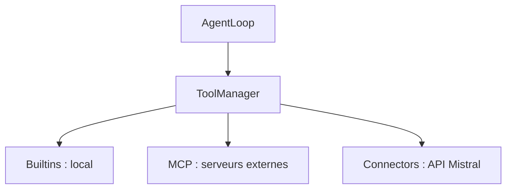

# Les Connectors de Mistral Vibe

*Chaque partie comporte 2 à 3 phrases simples, puis le schéma ou le tableau à afficher.*

---

## 1. C'est quoi ?

> Les Connectors permettent à Vibe d'utiliser des outils hébergés par l'API Mistral, comme la recherche web. Pour l'agent, ils s'utilisent comme des outils normaux. Ce sont en fait des outils MCP spécialisés.

- Outils MCP spécialisés
- Passage par `/v1/connectors-gateway/`
- Aucune différence pour l'agent avec un autre outil

---

## 2. Positionnement : 3 familles d'outils

> Vibe a trois familles d'outils : les Builtins en local, les outils MCP sur des serveurs externes, et les Connectors sur l'API Mistral. Tous utilisent la même interface et sont gérés par le `ToolManager`.



| | Builtins | MCP | Connectors |
|---|---|---|---|
| **Origine** | Code Python local | Serveurs MCP externes | API Mistral |
| **Exécution** | Locale | Distante, configurable | Distante, URL et auth fixes |
| **Découverte** | Statique | `list_tools_http` / `stdio` | `/v1/connectors/bootstrap` |
| **Cache** | Aucun | 24 h | 10 min + mémoire |
| **Authentification** | Aucune | Configurable | Bearer `MISTRAL_API_KEY` |
| **Réseau obligatoire** | Non | Selon le serveur | Oui |

---

## 3. Architecture

> Les Connectors héritent de MCP : `ConnectorProxyTool` hérite de `MCPTool`. Un proxy est un intermédiaire qui ressemble à un outil local mais envoie l'appel au service distant. Comme ils réutilisent le code d'appel de MCP, ils profitent de ses corrections.

```
BaseTool
  └── MCPTool
        └── ConnectorProxyTool
```

| Composant | Rôle |
|-----------|------|
| `ConnectorRegistry` | Découvre les connectors, gère le cache et l'OAuth |
| `ConnectorProxyTool` | Proxy généré pour chaque outil distant |
| `ToolManager` | Enregistre et filtre tous les outils |

---

## 4. Fonctionnement

> Pour découvrir les outils, Vibe regarde d'abord le cache, puis appelle l'API si besoin, et crée un proxy par outil. Quand l'agent utilise un outil, le proxy envoie la requête à l'API Mistral avec la clé d'API et renvoie le résultat.

**Découverte**

```
get_tools_async()
  ├─ cache mémoire rempli ? → retour immédiat
  └─ sinon → _discover_all()
       ├─ lit le cache fichier
       ├─ sinon appelle /v1/connectors/bootstrap
       ├─ déduplique les noms (wiki, wiki_2)
       └─ crée un proxy par outil
ToolManager.integrate_connectors_async() → enregistre les outils
```

**Exécution**

```
Agent → ToolManager.get("connector_web_search")
      → invoke() : validation des arguments
      → run() → call_tool_http(URL fixe + Bearer)
      → API Mistral → résultat
```

---

## 5. Le cache

> Pour éviter d'appeler l'API à chaque fois, la liste des outils est gardée en cache pendant 10 minutes, dans un fichier et en mémoire. Ces 10 minutes s'appellent le TTL : passé ce délai, on redemande à l'API. Le TTL est court car l'état d'un connector peut changer en cours de session.

| Niveau | Durée | Emplacement | Persistance |
|--------|-------|-------------|-------------|
| **Fichier** | 10 min (TTL) | `$VIBE_HOME/connector_bootstrap_cache.json` | Survit au redémarrage |
| **Mémoire** | Durée du registry | `ConnectorRegistry._cache` | Perdu au redémarrage |

```
14h00  cache vide          → appel API   → stocké
14h05  cache de 5 min      → valide      → réutilisé
14h12  cache de 12 min     → périmé      → nouvel appel API
```

Un nouvel appel API a lieu si : cache absent, expiré, illisible, invalide ou `force_refresh`.

---

## 6. Authentification et sécurité

> L'authentification utilise toujours un jeton Bearer construit avec la clé d'API Mistral. Cette clé n'est jamais écrite dans le fichier de cache, et un test le vérifie. Elle reste seulement en mémoire.

| Opération | Mécanisme |
|-----------|-----------|
| Exécution et bootstrap | `Authorization: Bearer {MISTRAL_API_KEY}` |
| OAuth | `get_auth_url()` renvoie l'URL à ouvrir |

| Endroit | Clé d'API présente ? |
|---------|----------------------|
| Fichier de cache | Non |
| Mémoire (proxies) | Oui |
| Requêtes sortantes | Oui |

---

## 7. Gestion des erreurs

> Chaque erreur HTTP est traduite en un message clair qui dit quoi faire. Par exemple, pour une erreur 401, on vérifie la clé d'API, et pour une erreur serveur, on réessaie avec `/reload`.

| Erreur | Message | Action |
|--------|---------|--------|
| 401 / 403 | Échec d'authentification | Vérifier `MISTRAL_API_KEY` |
| 404 | Connector introuvable | Vérifier son existence |
| 5xx | Problème serveur | Réessayer avec `/reload` |
| Timeout | Service lent ou injoignable | Vérifier la connexion |
| Connexion | Proxy injoignable | Vérifier le réseau |

---

## 8. Les tests

> Il y a cinq fichiers de tests, dont le principal est `test_connectors.py`. Il couvre bien la découverte, le cache, les erreurs et le filtrage. Il manque des tests de concurrence, de validation de schéma et de performance.

| Fichier | Niveau |
|---------|--------|
| `tests/tools/test_connectors.py` | Intégration (cœur de la suite) |
| `tests/app_server/test_connector_catalog.py` | Unitaire |
| `tests/cli/test_connector_auth_app.py` | Intégration (OAuth) |
| `tests/acp/test_connectors.py` | Contrat |
| `tests/agent_loop/e2e/test_e2e_connectors.py` | End-to-end |

| Bien couvert | Non couvert |
|--------------|-------------|
| Découverte, cache, erreurs HTTP | Concurrence |
| Exécution, filtrage | Validation de schéma |
| Clé d'API absente du cache | TTL exact, payloads malformés, performance |

---

## 9. Avantages

> L'architecture est simple à étendre, et l'agent traite tous les outils de la même façon. Le cache réduit les appels, les erreurs sont claires et la clé d'API est protégée.

1. **Architecture modulaire** : une sous-classe, un registry, une intégration
2. **Transparence pour l'agent** : même interface pour tous les outils
3. **Cache à deux niveaux** : moins d'appels, démarrage rapide
4. **Messages d'erreur exploitables**
5. **Sécurité de la clé d'API** dans le cache
6. **Réutilisation du code MCP** (`call_tool_http`)
7. **Contrôle par configuration** (désactivation fine)

---

## 10. Limites

> La limite principale est la dépendance à l'API Mistral : si elle est en panne, plus aucun connector n'est disponible. Il n'y a pas non plus de métriques, ni de mode local pour développer.

| Limite | Gravité |
|--------|---------|
| Dépendance à l'API Mistral, pas de repli sur un cache expiré | **Élevée** |
| Aucune métrique d'observabilité | Moyenne à élevée |
| Pas de mode local de développement | Moyenne |
| Pas de validation de schéma | Moyenne |
| Pas de revalidation conditionnelle (ETag) | Faible à moyenne |
| Déduplication silencieuse des noms | Faible à moyenne |
| TTL court : impact non mesuré | Faible à moyenne |
| Clé d'API en mémoire dans les proxies | Faible |

---

## 11. Recommandations

> Les deux priorités sont d'ajouter des métriques et de réutiliser le dernier cache quand l'API est en panne. Ensuite, on pourrait valider les réponses de l'API et compléter les tests.

| Priorité | Actions |
|----------|---------|
| **Haute** | 1. Ajouter des métriques (appels, latence, erreurs, hit/miss) <br> 2. Réutiliser un cache expiré si l'API est en panne, en le signalant |
| **Moyenne** | 3. Valider le bootstrap avec Pydantic <br> 4. Mesurer avant de modifier le TTL, puis étudier un ETag <br> 5. Créer un mode local <br> 6. Alias déterministes et avertissement à l'utilisateur |
| **Basse** | 7. Tests de concurrence, de TTL exact et de payloads malformés <br> 8. Documenter les prérequis du test E2E <br> 9. Vérifier les permissions du fichier de cache |

---

## À retenir

> Les Connectors sont des outils MCP spécialisés pour l'API Mistral, avec un cache de 10 minutes et une clé d'API jamais écrite dans le cache. Leur point faible est la dépendance à l'API.

- Outils MCP spécialisés pour l'**API Mistral**
- Découverte par **bootstrap**, cache **fichier de 10 minutes** + mémoire
- Authentification **Bearer fixe**, clé **jamais écrite** dans le cache
- Point faible : **dépendance à l'API Mistral**
- Priorités : **observabilité** et **repli sur cache expiré**
